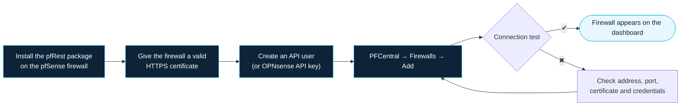

# 🧱 Adding a firewall

PFCentral talks to each firewall through its REST API over HTTPS. Set the firewall up once, then add it to
PFCentral.

## pfSense

1. Install the **[pfRest (pfSense-pkg-RESTAPI)](https://github.com/pfrest/pfSense-pkg-RESTAPI)** package on the firewall.
2. Make sure the firewall's web interface uses HTTPS (see the certificate options below).
3. In PFCentral: **Firewalls → Add**, choose **pfSense**, enter the address, port and API credentials.

## OPNsense

1. In OPNsense, create an API key for a user with the pages PFCentral needs (**System → Access → Users → API keys**).
2. In PFCentral: **Firewalls → Add**, choose **OPNsense**, enter the address, the key and the secret.

## The firewall's HTTPS certificate

PFCentral always connects over HTTPS and never turns certificate checking off.

| Option | When to use it |
| :-- | :-- |
| **Let's Encrypt (ACME)** on the firewall | Recommended: works without any extra steps |
| **Commercial certificate** | Works without any extra steps |
| **Self-signed or private CA** | Enroll the certificate in PFCentral: it remembers the firewall's key and refuses the connection if it ever changes |

Step-by-step details are in the **[install guide](https://github.com/tr0uble84/pfcentral/blob/main/docs/INSTALL.md#firewall-https-certificate-requirements)**.

## Companies

Every firewall belongs to a **company**. Company admins and read-only users only ever see their own company's
firewalls; global admins see all of them.

Next: **[Deployments →](Deployments)**
