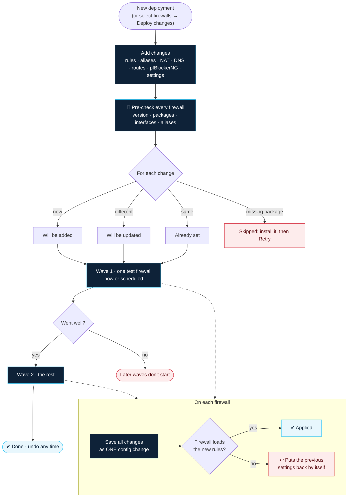

# 📦 Deployments

Send **the same change to many pfSense firewalls at once**: checked first, rolled out in waves, saved as one
configuration change per firewall, and undone automatically if a firewall can't load it.

## The flow

## What you can deploy

| Group | Changes |
| :-- | :-- |
| **Firewall** | Rules (top or bottom of an interface's list), floating rules, aliases, schedules |
| **NAT** | Port forwards (with their pass rule), outbound NAT, 1:1 NAT |
| **DNS and routing** | DNS Resolver host and domain overrides, static routes |
| **pfBlockerNG** | IPv4 and IPv6 lists, DNSBL groups |
| **System** | Tunables, DNS servers, time (NTP) servers, remote logging, time zone |

Every change can also **remove** an item (an old rule, alias or port forward) from many firewalls.

## Handy details

- **Same name, same change:** an alias or list with the same name, or a rule with the same description on the same
  interface, is updated to match. Nothing is duplicated.
- **Every internal interface:** enter `@internal` as the interface to put a rule on every LAN-type interface.
- **Copy from a firewall:** read one firewall's rules, aliases, NAT, DNS overrides, routes, pfBlockerNG lists and
  settings, tick what you want, and deploy them to others. Nothing on that firewall changes.
- **Undo** per firewall or for the whole deployment: removes what was added and puts back what was changed.
- **Who can deploy:** only the Microsoft 365 people and groups a global admin picks under
  **Deployments → Who can deploy**. Until someone is picked, nobody can deploy.

Next: **[Upgrades →](Upgrades)**
