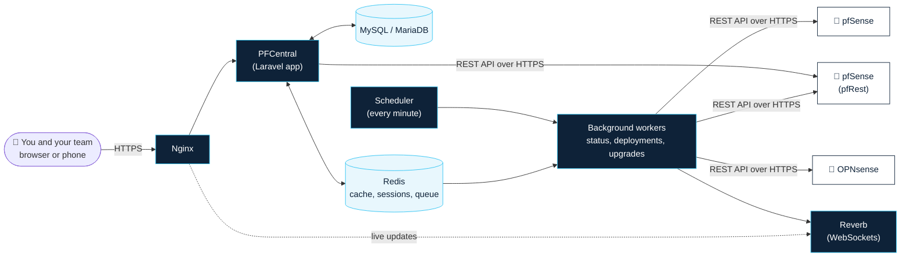

  

<h1 align="center">PFCentral Wiki</h1>

  Manage, change, upgrade and secure every pfSense firewall you look after, from one console. 
  
  
  

---

## Start here

| | Page | What you'll find |
| :-: | :-- | :-- |
| 🚀 | **[Installation](Installation)** | One command, a guided wizard, checks at every step |
| 🧱 | **[Adding a firewall](Adding-a-Firewall)** | pfRest, HTTPS and connecting pfSense or OPNsense |
| 📦 | **[Deployments](Deployments)** | One change to many firewalls: pre-checks, waves, undo |
| ⬆️ | **[Upgrades](Upgrades)** | pfSense upgrades in waves, with backups first |
| 🔐 | **[VPN Access](VPN-Access)** | WireGuard remote access with Microsoft 365 sign-in |
| 🛡️ | **[Security](Security)** | Two-factor, firewall web interfaces through PFCentral, locks |
| 🔌 | **[REST API](REST-API)** | Inventory and live status for your own tools |
| 🧰 | **[Troubleshooting](Troubleshooting)** | Fixing a stopped install, error reports, common problems |
| ❓ | **[FAQ](FAQ)** | Short answers |

## How PFCentral fits together

PFCentral reaches each firewall's REST API over HTTPS, so each firewall only needs its API reachable from the
PFCentral server. Every firewall's credentials are stored encrypted, and each company only sees its own firewalls.

## What's in each version

See the **[Versions table in the README](https://github.com/tr0uble84/pfcentral#versions)** and the full
**[changelog](https://github.com/tr0uble84/pfcentral/blob/main/CHANGELOG.md)**. What's planned is on the
**[PFCentral Roadmap](https://github.com/users/tr0uble84/projects/1)**.

## Get help or help out

- Something broke? **[Open an issue](https://github.com/tr0uble84/pfcentral/issues/new/choose)**.
- Want to contribute? Read **[CONTRIBUTING](https://github.com/tr0uble84/pfcentral/blob/main/CONTRIBUTING.md)**, fork, and open a pull request.
- Found a security problem? Report it privately: **[SECURITY](https://github.com/tr0uble84/pfcentral/blob/main/SECURITY.md)**.
