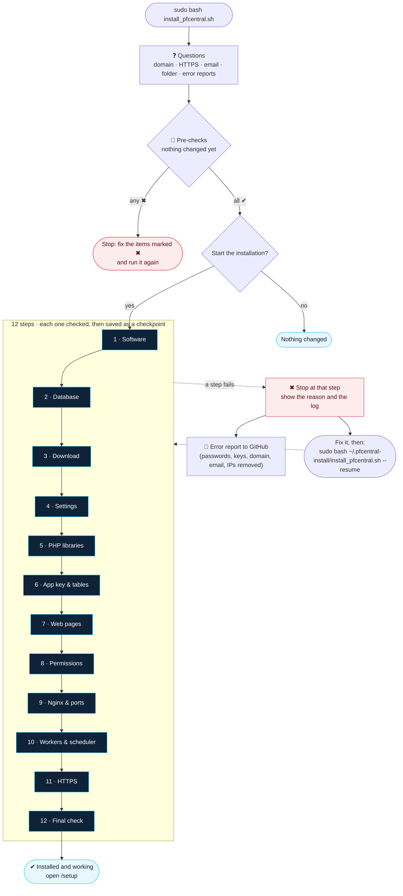

# 🚀 Installation

PFCentral installs on a fresh Linux server with **one guided command**. The installer asks a few questions,
checks the server **before changing anything**, then installs in 12 steps. After every step it **checks that the
step worked** and saves a checkpoint. If something fails, it stops right there, tells you why, and you continue
where it stopped.

## Quick start

```bash
curl -fsSL https://raw.githubusercontent.com/tr0uble84/pfcentral/main/install_pfcentral.sh -o install_pfcentral.sh
sudo bash install_pfcentral.sh
```

When it finishes, open `https://your-domain/setup` to create your administrator account.

## How the installer works



## Before you start

| | Minimum | Recommended |
| :-- | :-- | :-- |
| **System** | Ubuntu 22.04 | **Ubuntu 24.04 LTS** (Fedora 42+ also supported; Debian, RHEL family, Arch and openSUSE are experimental) |
| **CPU** | x86_64 or arm64 | 2 cores or more |
| **Memory** | 2 GB | 4 GB |
| **Disk** | 5 GB free | 10 GB free |
| **Ports** | 80 and 443 reachable from the internet (for HTTPS) | |
| **DNS** | an A record for your domain pointing to the server | |

## The questions

| Question | What it's for |
| :-- | :-- |
| **Domain name** | The address you'll open PFCentral at, e.g. `console.example.com`. Leave it empty to use the server's IP. |
| **HTTPS certificate** | A free Let's Encrypt certificate for that domain, renewed automatically. |
| **Email** | Let's Encrypt's expiry notices. |
| **Install folder** | Where PFCentral lives. Default: `/var/www/pfcentral`. |
| **Error reports** | If a step fails, send a report to the developers on GitHub so it gets fixed. |

A strong database password is generated for you and saved in the app's `.env` file.

## What the pre-checks look at

Nothing on the server changes while these run. Any ✖ stops the installer before it touches anything.

| Check | Stops when |
| :-- | :-- |
| Operating system and systemd | the system isn't supported, or systemd isn't running |
| CPU, memory, free disk | below the minimum above |
| Internet | GitHub, Composer or npm can't be reached |
| Ports 80, 443, 3306, 6379, 8080 | another program is using one (it names the program) |
| Other web servers | Apache, Caddy or lighttpd is running |
| Install folder | PFCentral is already installed there, or the folder isn't empty |
| Domain | the domain doesn't resolve, or (with HTTPS) points to another server |

## The 12 steps and their checks

| # | Step | Checked afterwards |
| :-: | :-- | :-- |
| 1 | Software: Nginx, PHP, MySQL, Redis, Supervisor, Composer, Node.js | every program and PHP extension present, services running |
| 2 | Database and its user | the app can sign in to its database |
| 3 | Download PFCentral | the download is complete |
| 4 | Settings (`.env`) | every required setting is there |
| 5 | PHP libraries (Composer) | the app's command line starts |
| 6 | App key and database tables | key created, no tables pending |
| 7 | Build the web pages | the page build exists |
| 8 | Permissions and safe admin helpers | the web user can write where it must, and nowhere it shouldn't |
| 9 | Web server (Nginx) and firewall ports | the home page answers |
| 10 | Background workers, live updates, scheduler | every worker is running |
| 11 | HTTPS certificate | the site answers over HTTPS |
| 12 | Final check | everything above, once more |

## Options

| Option | What it does |
| :-- | :-- |
| `--check` | Only the questions and pre-checks; nothing is installed |
| `--resume` | Continue an installation that stopped |
| `--verbose` | Show every command's output while installing |
| `--unattended` | No questions: use the settings below |

**Settings for `--unattended`:** `PFC_DOMAIN`, `PFC_EMAIL`, `PFC_HTTPS=yes|no`, `PFC_REPORT=yes|no`,
`INSTALL_DIR`, `DB_USER`, `DB_PASS`.

```bash
sudo PFC_DOMAIN=console.example.com PFC_EMAIL=you@example.com PFC_HTTPS=yes PFC_REPORT=yes \
  bash install_pfcentral.sh --unattended
```

## Safer by design

- The web app may only run five small helper scripts as root, for its own certificates and Nginx settings, never
  `certbot` or `nginx` directly.
- The install log (`/var/log/pfcentral-install.log`) and `.env` are readable by root only (`.env` also by the web
  server's user).
- Error reports never include passwords, keys, your domain, your email or IP addresses.

## Manual installation

Prefer to install each part yourself? Follow the **[manual install guide](https://github.com/tr0uble84/pfcentral/blob/main/docs/INSTALL.md)**.

Next: **[Adding a firewall →](Adding-a-Firewall)**
