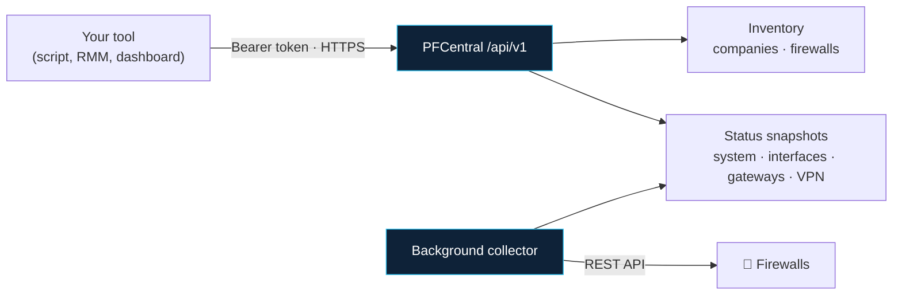

# 🔌 REST API

A read-only, token-based REST API under **`/api/v1`** for your own tools: company and firewall inventory, plus live
status collected in the background.

## Endpoints

| Method | Path | Returns |
| :-- | :-- | :-- |
| GET | `/me` | The token's owner, scope and company |
| GET | `/companies` | All companies (MSP token) or the token's company |
| GET | `/companies/{id}` | One company |
| GET | `/firewalls` | Firewall inventory, paginated |
| GET | `/firewalls/{id}` | One firewall |
| GET | `/firewalls/{id}/status` | Live status of one firewall |
| GET | `/firewalls/status` | Live status of many firewalls |
| GET | `/openapi.json` | The OpenAPI 3 document |

## Good to know

- Tokens are issued from the server's command line only; there's no web page that creates them.
- A **company token** only ever sees its company. An **MSP token** (global admins only) sees every company.
- HTTPS is required, and requests are rate-limited (60 a minute per token by default).
- The API never calls a firewall itself: status comes from the background collector, with its age included.

Full details: **[inventory and tokens](https://github.com/tr0uble84/pfcentral/blob/main/docs/external-api-v1.md)** ·
**[status fields](https://github.com/tr0uble84/pfcentral/blob/main/docs/PFCENTRAL-STATUS-API.md)** ·
**[OpenAPI](https://github.com/tr0uble84/pfcentral/blob/main/docs/openapi-v1.json)**

Next: **[Troubleshooting →](Troubleshooting)**
