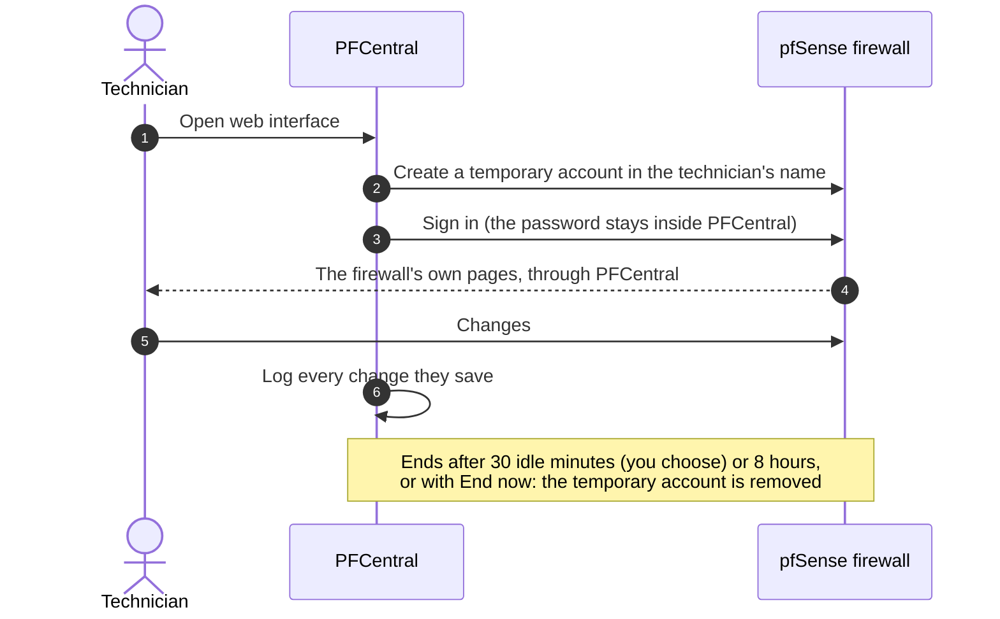

# 🛡️ Security

Everything on the **Security** page is off until a global admin turns it on.

## Signing in to PFCentral

- **Microsoft 365** for your own team: everyone in the groups you pick can sign in; membership is checked at every
  sign-in.
- **Email and password**, with optional or **required two-factor** (an authenticator app). When required,
  people must set it up before they can use PFCentral. Signing in with Microsoft 365 counts as two-factor.
- **Roles:** global admin, company admin, read-only. Each company only sees its own firewalls.

## Opening a firewall's web interface through PFCentral

No firewall password is ever shared with the technician, and read-only users can't open it.

## Locking a firewall's web interface

A locked firewall's web interface answers **only the addresses you allow** from the internet (LAN access is never
changed). Before locking, PFCentral checks that its own connection comes from an allowed address. If it can't
confirm the lock afterwards, **the firewall undoes it by itself within 3 minutes**.

## On the server

- Firewall credentials, backups and cached firewall settings are stored **encrypted**.
- The web app may only run five small helper scripts as root, for certificates and its Nginx settings.
- Report security problems privately: **[SECURITY.md](https://github.com/tr0uble84/pfcentral/blob/main/SECURITY.md)**.

Next: **[REST API →](REST-API)**
