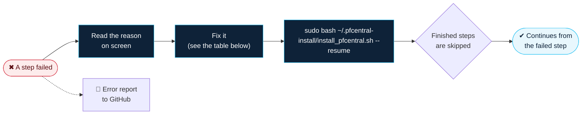

# 🧰 Troubleshooting

## The installer stopped

It stops at the step that failed and shows the reason and the last lines of the log. Nothing after that step was
changed.

| The installer says | What to do |
| :-- | :-- |
| *Port … is used by "…"* | Stop or move that program, or run PFCentral on another server |
| *… doesn't resolve yet* | Add a DNS A record for your domain pointing to the server, wait a few minutes |
| *… points to …, but this server's public IP is …* | Fix the DNS record, or install without HTTPS for now (`PFC_HTTPS=no`) |
| *Can't reach: …* | The server needs outbound HTTPS to GitHub, Composer and npm (check DNS, proxy, firewall) |
| *Let's Encrypt couldn't issue a certificate* | Port 80 must be open to the internet and the domain must point to this server |
| *npm could not install the build tools* | The server must reach `registry.npmjs.org`; run `--resume` again |
| *Nginx isn't running* | `sudo nginx -t` shows the problem; then `--resume` |

The full log is in **`/var/log/pfcentral-install.log`**.

## Error reports

When you allow it, a failed step sends a report to the developers as a GitHub issue labelled
**`installer-error`**, so problems get fixed for everyone.

- Passwords, keys, tokens, your domain, your email and IP addresses are **removed first**.
- A copy is saved on the server in `~/.pfcentral-install/` (root only).
- If the server can't send it, the installer prints a link that opens the report, already filled in, on GitHub.

## After installing

| Problem | Where to look |
| :-- | :-- |
| A page shows an error | `/var/www/pfcentral/storage/logs/laravel.log` |
| Firewall status doesn't update | `sudo supervisorctl status`: the `pfcentral-worker` entries should be RUNNING |
| Live updates don't arrive | `sudo supervisorctl status pfcentral-reverb` and `storage/logs/reverb.log` |
| Scheduled checks don't run | `/etc/cron.d/pfcentral` must exist |
| Logo or favicon shows *403* | See *Troubleshooting* in the **[install guide](https://github.com/tr0uble84/pfcentral/blob/main/docs/INSTALL.md)** |

Still stuck? **[Open an issue](https://github.com/tr0uble84/pfcentral/issues/new/choose)**.
