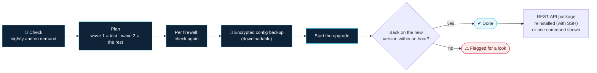

# ⬆️ Upgrades

An upgrade centre for pfSense: every firewall is checked first, its configuration is backed up, and upgrades go
out in waves.

## What the check looks at

- the firewall's version, and whether a newer one is offered
- free disk space
- saved configuration versions
- the way back (ZFS boot environments)
- the REST API package

Each wave is started by hand, and only after the earlier waves finished well.

> **Note:** a pfSense upgrade removes the REST API package. With SSH set up for the firewall, PFCentral reinstalls
> it by itself; otherwise the page shows the one command to run, then **Check again**.

Next: **[VPN Access →](VPN-Access)**
