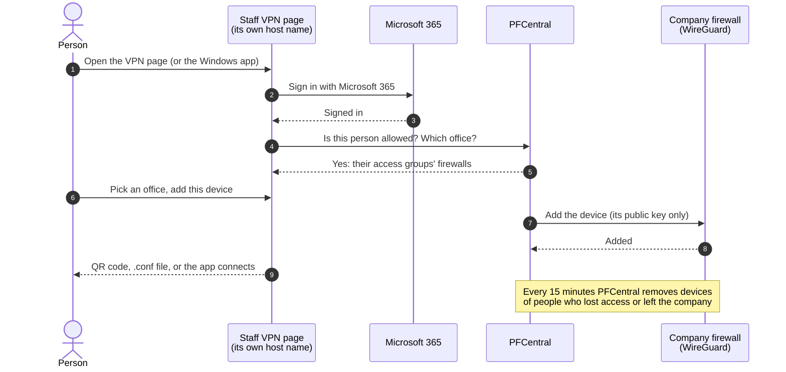
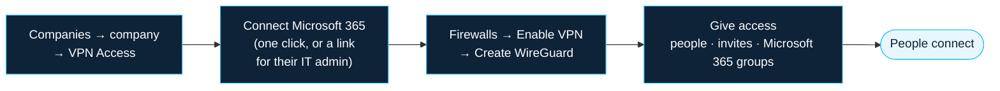

# 🔐 VPN Access

Self-service **WireGuard remote access** for each company, with **Microsoft 365 (Entra ID)** sign-in or
email-and-password accounts with two-factor. PFCentral builds the tunnel on the company's firewall and keeps
access in step with who is allowed.

## How a person gets connected

## Setting up a company

**Create WireGuard** builds the tunnel and its rules on the firewall: DNS to the firewall, the firewall's admin
pages blocked, the chosen LAN allowed, other private networks blocked, internet allowed, plus the WAN rule. On
pfSense it installs the WireGuard package first if it's missing. A tunnel set up by hand can be adopted instead.

## Features

- **Access groups:** for companies with several firewalls, groups decide who may use which firewall, and can be
  linked to Microsoft 365 groups.
- **Email-and-password accounts** for companies without Microsoft 365, with invitations, password links and
  optional or required two-factor.
- **Live connections:** who is connected right now, from where and with how much traffic, with **Disconnect** and
  **Block**.
- **Windows app:** sign-in, diagnostics and support tickets from inside the app.

Next: **[Security →](Security)**
